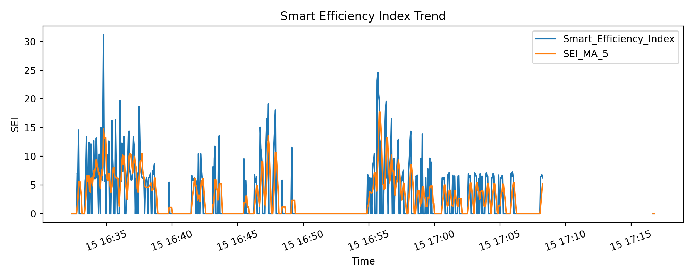
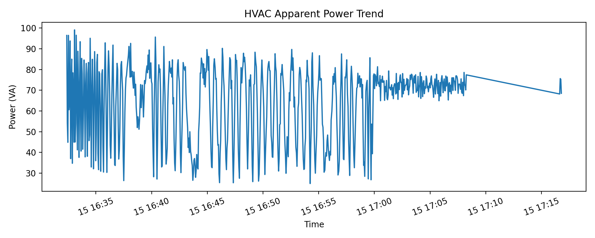
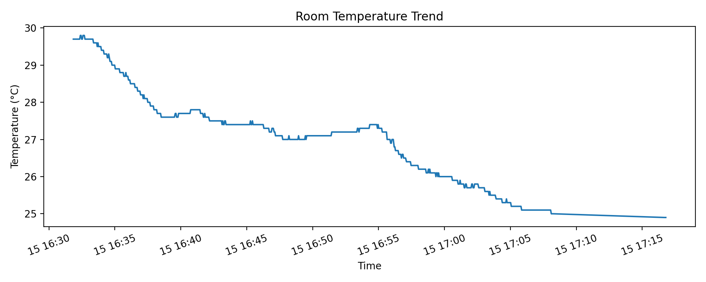

# AI-Driven IoT Framework for Energy Optimisation in Ductless HVAC Systems

### Final-Year Computer Engineering Project

An IoT-based HVAC monitoring system developed using Python, Raspberry Pi and machine learning techniques to analyse energy efficiency, monitor operating conditions and identify unusual performance patterns.

The project combines hardware integration, real-time data processing, adaptive monitoring and a Flask-based dashboard.

---

## 1. Project Overview

Air conditioning systems consume significant amounts of electrical energy, and changes in their operating efficiency can be difficult to identify without continuous monitoring.

This project explores how IoT sensors and Python-based data analysis can be used to monitor the performance of ductless HVAC systems.

The system collects environmental and electrical measurements, processes the readings and evaluates HVAC performance using a Smart Efficiency Index (SEI).

An adaptive monitoring approach was also developed to establish a baseline from initial operating measurements and identify deviations from expected performance.

The results are presented through a monitoring dashboard and automatically generated visualisations.

---

## 2. Technologies Used

### Programming and Development
- Python
- Flask
- Git
- GitHub

### Hardware
- Raspberry Pi
- DHT22 Temperature and Humidity Sensor
- ACS712 Current Sensor
- ZMPT101B Voltage Sensor
- ADS1115 Analog-to-Digital Converter

### Data Processing and Analysis
- Pandas
- NumPy
- Machine Learning
- Anomaly Detection
- Excel and CSV Data Processing

### Visualisation
- Flask Dashboard
- Matplotlib
- Real-Time Monitoring Graphs

---

## 3. System Architecture

The monitoring system follows a sensor-to-dashboard workflow.

**Sensor Data Collection**

Environmental and electrical measurements are collected using sensors connected to a Raspberry Pi.

↓

**Data Processing**

Python scripts process sensor readings and prepare the measurements for efficiency analysis.

↓

**Efficiency Evaluation**

The system calculates a Smart Efficiency Index (SEI) to assess HVAC operating performance.

↓

**Adaptive Monitoring**

An initial baseline is established and subsequent measurements are evaluated against the learned operating conditions.

↓

**Dashboard and Reporting**

Monitoring information, efficiency trends and generated results are presented through a Flask dashboard.

---

## 4. Key Features

### Real-Time IoT Monitoring

The system collects environmental and electrical measurements from the HVAC system using connected sensors.

### Smart Efficiency Index (SEI)

A custom efficiency indicator was developed to evaluate HVAC performance using cooling-related measurements and electrical power.

### Adaptive Baseline Learning

The monitoring system establishes an initial operating baseline instead of relying entirely on fixed thresholds.

Subsequent readings are compared against the baseline to identify changes in operating behaviour.

### Anomaly Detection

The project explores machine learning and anomaly detection techniques for identifying unusual HVAC operating patterns.

### Data Processing and Storage

Python-based processing pipelines handle sensor readings and store monitoring data for analysis.

### Monitoring Dashboard

A Flask-based dashboard displays monitoring information and efficiency trends.

### Automated Visualisation

The system generates graphs to visualise changes in operating conditions and efficiency.

---

## 5. Project Screenshots

### HVAC Monitoring Dashboard


### Smart Efficiency Index Trend



### Power Consumption Trend



### Temperature Trend



---

## 6. Repository Structure

```text
AI-Driven-IoT-HVAC/
│
├── Approach_4_Adaptive_AI/
│   ├── Results/
│   ├── input_data/
│   ├── output_data/
│   ├── dashboard.py
│   ├── hvac_efficiency_analyzer.py
│   ├── live_hvac_adaptive_ai.py
│   └── live_hvac_efficiency_pi.py
│
├── Final year project phase1/
│   └── Project documentation and planning materials
│
└── README.md
```

### Approach 4 - Adaptive AI

Contains the Python implementation, monitoring scripts, dashboard, input data and generated results.

### Final Year Project Phase 1

Contains documentation and planning materials from the initial development stage.

---

## 7. Development Challenges

### Hardware and Software Integration

Integrating multiple sensors with the Raspberry Pi required handling sensor communication, collecting measurements and processing the readings through Python.

### Real-Time Data Processing

Developing the monitoring pipeline involved collecting and analysing measurements while maintaining consistent data storage and visualisation.

### Adaptive Monitoring

One of the key challenges was developing an approach that could evaluate changing operating conditions without relying exclusively on predetermined thresholds.

### Data Visualisation

The dashboard was developed to present technical measurements and efficiency trends in an understandable format.

---

## 8. What I Learned

Working on this project helped me gain practical experience in:

- Python application development
- Hardware and software integration
- IoT sensor communication
- Data processing and analysis
- Machine learning concepts
- Anomaly detection
- Flask dashboard development
- Troubleshooting technical problems
- Building and testing an end-to-end monitoring system

The project also reinforced the importance of testing individual components, validating measurements and refining implementations when initial approaches did not perform as expected.

---

## 9. Project Status

Completed as a final-year Computer Engineering project.

The repository contains project implementations, documentation, sample data and generated monitoring results.

Running the complete monitoring system requires the appropriate Raspberry Pi hardware and connected sensors.

---

## Author

**Luke Rommel**

Computer Engineering Graduate | Python | AI | IoT | Software Development

[LinkedIn](https://www.linkedin.com/in/luke-rommel-a405452ba/)
